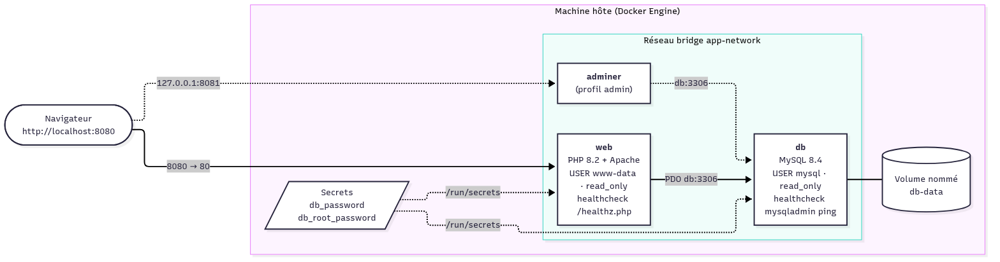

# Conteneurisation d'une application Web multi-tiers avec Docker


Projet de M2 : conteneurisation d'une application PHP/MySQL de gestion d'articles. L'application tourne dans deux conteneurs orchestrés par Docker Compose, avec des images optimisées et durcies, un pipeline CI/CD GitHub Actions et une publication sur Docker Hub.

Le rapport technique détaillé (justification de chaque instruction, mesures, résultats des scans) se trouve dans [`docs/rapport-technique.md`](docs/rapport-technique.md), avec une version [PDF](docs/rapport-technique.pdf).

---

## Sommaire

1. [Architecture](#1-architecture)
2. [Arborescence du dépôt](#2-arborescence-du-dépôt)
3. [Prérequis](#3-prérequis)
4. [Démarrage rapide](#4-démarrage-rapide)
5. [Variables d'environnement et secrets](#5-variables-denvironnement-et-secrets)
6. [Commandes utiles](#6-commandes-utiles)
7. [Procédure de test](#7-procédure-de-test)
8. [Sécurité](#8-sécurité)
9. [Optimisation des images](#9-optimisation-des-images)
10. [CI/CD et publication Docker Hub](#10-cicd-et-publication-docker-hub)
11. [Dépannage](#11-dépannage)
12. [Auteurs](#12-auteurs)

---

## 1. Architecture



| Service   | Image                                   | Rôle                                         | Exposition                    |
|-----------|-----------------------------------------|----------------------------------------------|-------------------------------|
| `web`     | `php:8.2-apache` (multi-stage)          | Front-end + traitement PHP (PDO)             | `localhost:8080` → port 80    |
| `db`      | `mysql:8.4` + script d'initialisation   | Stockage des articles                        | aucune (réseau interne)       |
| `adminer` | `adminer:5` *(optionnel, profil admin)* | Administration de la base                    | `127.0.0.1:8081` uniquement   |

- **Réseau** : `app-network` est un bridge personnalisé. Les conteneurs se joignent par leur nom de service (`db`) grâce au DNS interne de Docker.
- **Volume** : `db-data` est un volume nommé, monté sur `/var/lib/mysql`. Les données survivent à `docker compose down`.
- **Secrets** : les mots de passe sont montés en fichiers dans `/run/secrets/`. Ils ne sont jamais écrits dans une image ni dans une variable d'environnement.
- **Ordre de démarrage** : `web` attend que `db` soit `healthy` (`depends_on: condition: service_healthy`).

## 2. Arborescence du dépôt

```
.
├── .github/workflows/docker.yml   # pipeline CI/CD
├── db/
│   ├── Dockerfile                 # image MySQL 8.4
│   ├── conf.d/app.cnf             # configuration serveur (utf8mb4, local_infile=OFF)
│   └── init/01-articles.sql       # création de la table articles
├── docs/
│   ├── architecture.mmd / .png    # schéma d'architecture (Mermaid)
│   ├── Dockerfile.naive           # version non optimisée, pour comparaison
│   └── rapport-technique.md / .pdf
├── scripts/init-secrets.sh        # génère .env et les mots de passe
├── secrets/                       # mots de passe générés (non versionnés)
├── src/                           # code PHP de l'application
├── web/
│   ├── Dockerfile                 # image web multi-stage
│   ├── apache/                    # vhost + configuration de sécurité
│   └── php/app.ini                # surcharges php.ini de production
├── .dockerignore
├── .env.example
├── .trivyignore
└── docker-compose.yml
```

## 3. Prérequis

| Outil          | Version minimale | Vérification               |
|----------------|------------------|----------------------------|
| Docker Engine  | 24+              | `docker --version`         |
| Docker Compose | v2.24+ (plugin)  | `docker compose version`   |
| Git            | 2.x              | `git --version`            |
| Port libre     | 8080             | `lsof -i :8080` (vide)     |

Testé sous macOS (Docker Desktop 29, Apple Silicon). La CI exécute les mêmes tests sur Ubuntu (runner GitHub Actions, amd64).

## 4. Démarrage rapide

```bash
git clone https://github.com/Spitchy/Projet_Final_Docker.git
cd Projet_Final_Docker

# 1. crée .env à partir de .env.example et génère des mots de passe aléatoires
./scripts/init-secrets.sh

# 2. construit les images et démarre la stack en arrière-plan
docker compose up -d --build

# 3. vérifie que les deux services sont "healthy"
docker compose ps
```

L'application est disponible sur **http://localhost:8080**.

Pour utiliser les images publiées sur Docker Hub (`ishakdocker67/projet-docker-web` et `ishakdocker67/projet-docker-db`) au lieu de les construire :

```bash
docker compose pull && docker compose up -d
```

## 5. Variables d'environnement et secrets

Fichier `.env` (copié depuis [`.env.example`](.env.example), jamais versionné) :

| Variable               | Défaut                 | Description                                              |
|------------------------|------------------------|----------------------------------------------------------|
| `COMPOSE_PROJECT_NAME` | `projet-docker`        | Préfixe des ressources Compose (volume, etc.)            |
| `DOCKERHUB_USER`       | `ishakdocker67`        | Compte Docker Hub utilisé pour nommer les images         |
| `TAG`                  | `latest`               | Tag des images construites ou tirées                     |
| `WEB_PORT`             | `8080`                 | Port de l'hôte redirigé vers Apache                      |
| `DB_NAME`              | `test`                 | Nom de la base créée au premier démarrage                |
| `DB_USER`              | `test`                 | Utilisateur applicatif MySQL                             |

Secrets (générés par `scripts/init-secrets.sh`, ignorés par Git) :

| Fichier                         | Monté dans                         | Utilisé par                          |
|---------------------------------|------------------------------------|--------------------------------------|
| `secrets/db_password.txt`       | `/run/secrets/db_password`         | `web` (`DB_PASSWORD_FILE`), `db` (`MYSQL_PASSWORD_FILE`) |
| `secrets/db_root_password.txt`  | `/run/secrets/db_root_password`    | `db` (`MYSQL_ROOT_PASSWORD_FILE`)    |

Pour changer un mot de passe, modifiez le fichier *avant* le premier démarrage. MySQL n'applique ces valeurs que lorsque le volume est vide. Sinon, il faut réinitialiser avec `docker compose down -v`.

## 6. Commandes utiles

| Action                                   | Commande                                         |
|------------------------------------------|--------------------------------------------------|
| Démarrer                                 | `docker compose up -d`                           |
| Reconstruire après modification          | `docker compose up -d --build`                   |
| État et healthchecks                     | `docker compose ps`                              |
| Logs en continu                          | `docker compose logs -f web`                     |
| Arrêter (données conservées)             | `docker compose down`                            |
| Arrêter et **supprimer les données**     | `docker compose down -v`                         |
| Lancer aussi Adminer                     | `docker compose --profile admin up -d`           |
| Client MySQL dans le conteneur           | `docker exec -it db mysql -u test -p test`       |

Adminer est accessible sur http://127.0.0.1:8081, serveur `db`, utilisateur `test`. Le mot de passe est dans `secrets/db_password.txt`.

## 7. Procédure de test

### 7.1 Fonctionnement

```bash
docker compose ps                                  # web et db : (healthy)
curl -s http://localhost:8080/healthz.php          # OK
```

Dans le navigateur, sur http://localhost:8080, remplissez le formulaire et cliquez sur **Envoyer** : l'article apparaît en tête de liste.

### 7.2 Persistance

```bash
# ajout d'un article (ou via l'interface)
curl -s -d 'title=Persistance&author=Moi&content=Test' http://localhost:8080/validation.php

docker compose down          # supprime les conteneurs et le réseau, PAS le volume
docker compose up -d
curl -s http://localhost:8080 | grep Persistance   # l'article est toujours là
```

### 7.3 Réseau et communication inter-conteneurs

```bash
docker network ls                         # app-network (bridge)
docker network inspect app-network        # sous-réseau + IP de web et db
docker exec -it web ping -c 3 db          # résolution DNS du nom de service
docker exec -it web curl --http0.9 http://db:3306 --output -   # handshake MySQL (version 8.4.x)
```

`curl http://db:3306` sans option renvoie `Received HTTP/0.9 when not allowed`. C'est la preuve que le port répond : MySQL parle son propre protocole, pas HTTP.

Le port 3306 n'est **pas** publié sur l'hôte : `nc -z localhost 3306` échoue.

### 7.4 Sécurité

```bash
docker exec web id                         # uid=33(www-data)
docker exec web touch /var/www/html/x      # Read-only file system
docker inspect web --format '{{.HostConfig.CapDrop}} {{.HostConfig.ReadonlyRootfs}}'
docker exec web env | grep -i pass         # seulement DB_PASSWORD_FILE, aucun mot de passe en clair
```

### 7.5 Scan de vulnérabilités

```bash
docker run --rm -v /var/run/docker.sock:/var/run/docker.sock \
  aquasec/trivy:0.76.1 image --severity HIGH,CRITICAL ishakdocker67/projet-docker-web:latest

# ou avec Docker Scout
docker scout cves ishakdocker67/projet-docker-web:latest
```

### 7.6 Déploiement sur une autre machine

```bash
git clone https://github.com/Spitchy/Projet_Final_Docker.git && cd Projet_Final_Docker
./scripts/init-secrets.sh && docker compose up -d --build --wait
```

Ce scénario est rejoué à chaque push par la CI, sur un runner vierge.

## 8. Sécurité

| Mesure                                    | Où                                    |
|-------------------------------------------|---------------------------------------|
| Utilisateur non-root (`www-data`, `mysql`) | `web/Dockerfile` (`USER`), entrypoint MySQL |
| Système de fichiers en lecture seule      | `read_only: true` + `tmpfs` (Compose) |
| Aucune capacité Linux pour `web`, 4 seulement pour `db` | `cap_drop: [ALL]` / `cap_add`  |
| Pas d'escalade de privilèges              | `security_opt: no-new-privileges`     |
| Mots de passe en secrets Docker           | `secrets:` (Compose), `*_FILE`        |
| Base non exposée hors du réseau Docker    | pas de `ports:` sur `db`              |
| Code applicatif non modifiable            | `root:www-data`, `0640` (pas de 777)  |
| Limites CPU / mémoire                     | `deploy.resources.limits`             |
| PHP / Apache sans fuite d'informations    | `expose_php=Off`, `ServerTokens Prod`, `display_errors=Off` |
| En-têtes HTTP de sécurité                 | `web/apache/000-default.conf`         |
| Correction XSS et validation              | `src/index.php`, `src/validation.php` |
| Scan Trivy bloquant en CI                 | `.github/workflows/docker.yml`        |

## 9. Optimisation des images

| Image                                       | Taille   |
|---------------------------------------------|----------|
| `php:8.2-apache` (base)                     | 714 Mo   |
| Web, version naïve (`docs/Dockerfile.naive`) | 890 Mo   |
| **Web, version optimisée (`web/Dockerfile`)** | **716 Mo** |

L'image optimisée n'ajoute que **2 Mo** à l'image de base, contre 176 Mo pour la version naïve. Les leviers utilisés :
- build multi-stage (compilation des extensions dans une étape séparée) ;
- une seule couche `apt` nettoyée, avec `--no-install-recommends` ;
- un `.dockerignore` en liste blanche.

Les choix et les mesures sont détaillés dans le rapport, partie 6.

## 10. CI/CD et publication Docker Hub

Le workflow [`.github/workflows/docker.yml`](.github/workflows/docker.yml) se déclenche sur `push`, sur `pull_request` vers `main` et à la demande. Il enchaîne trois jobs :

1. **lint** : `php -l` sur tout le code (conteneur `php:8.2-cli`) ;
2. **build-test** : étape `test` du Dockerfile, build Compose et démarrage avec `--wait`, tests fonctionnels (affichage, ajout, validation, ping, non-root, lecture seule), test de persistance, puis scan Trivy (échec en cas de CVE critique corrigeable) ;
3. **publish** : uniquement sur `main`. Connexion à Docker Hub, puis push multi-architecture (`amd64`, `arm64`) de `projet-docker-web` et `projet-docker-db` avec les tags `latest` et `<sha du commit>`.

**Configuration requise** (GitHub → *Settings → Secrets and variables → Actions*) :

| Secret               | Valeur                                                   |
|----------------------|----------------------------------------------------------|
| `DOCKERHUB_USERNAME` | nom d'utilisateur Docker Hub                             |
| `DOCKERHUB_TOKEN`    | *Personal Access Token* Docker Hub (droits Read & Write) |

**Publication manuelle** (sans CI) :

```bash
docker login
# DOCKERHUB_USER renseigné dans .env
docker compose build
docker compose push
# tag supplémentaire avec le SHA du commit
export TAG=$(git rev-parse HEAD)
docker compose build && docker compose push
```

**Images publiées** (multi-architecture `amd64` / `arm64`) :

| Image | Docker Hub | Tags |
|---|---|---|
| `ishakdocker67/projet-docker-web` | https://hub.docker.com/r/ishakdocker67/projet-docker-web | `latest`, `<sha du commit>` |
| `ishakdocker67/projet-docker-db`  | https://hub.docker.com/r/ishakdocker67/projet-docker-db  | `latest`, `<sha du commit>` |

Pour vérifier la publication : `docker pull ishakdocker67/projet-docker-web:latest`, ou la page `https://hub.docker.com/r/ishakdocker67/projet-docker-web`.

## 11. Dépannage

| Symptôme                                                    | Cause / solution                                                        |
|-------------------------------------------------------------|-------------------------------------------------------------------------|
| `Bind for 0.0.0.0:8080 failed: port is already allocated`    | Port occupé : changez `WEB_PORT` dans `.env`.                           |
| `secret file ... not found`                                 | Lancez `./scripts/init-secrets.sh` avant `docker compose up`.           |
| `web` reste `unhealthy`, « Impossible de charger les articles » | La base n'accepte pas le mot de passe : le volume a été créé avec un autre secret. Lancez `docker compose down -v`. |
| `dependency failed to start: container db is unhealthy`     | Consultez `docker compose logs db`. Le premier démarrage peut prendre ~30 s. |
| Modification du code non prise en compte                    | Le code est copié dans l'image : lancez `docker compose up -d --build`. |

## 12. Auteurs

- Ishak MESSAOUDI
- Mathias BOUCLON
