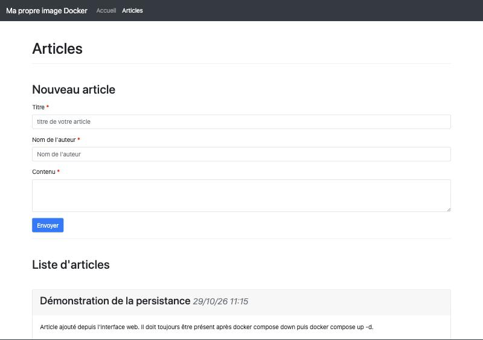
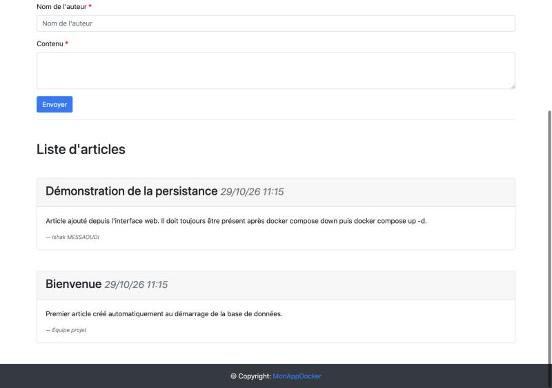
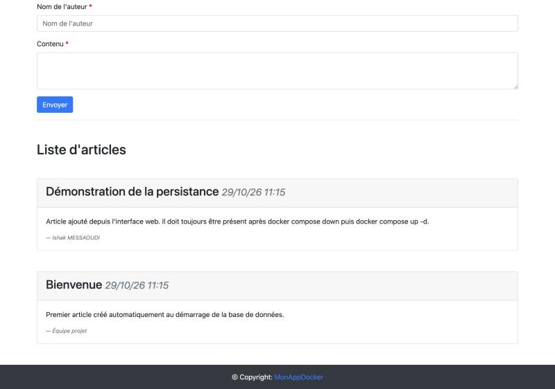
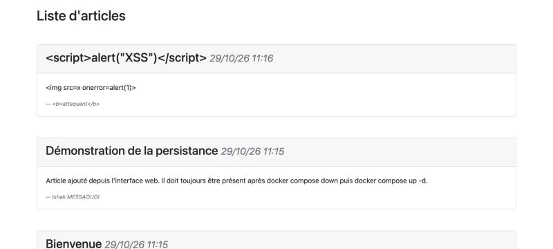
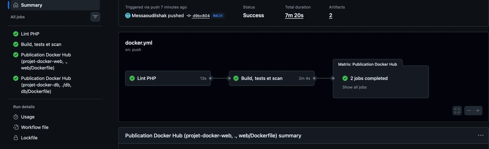
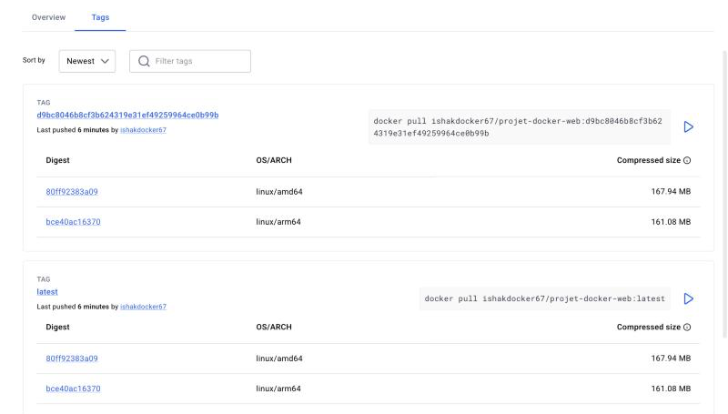
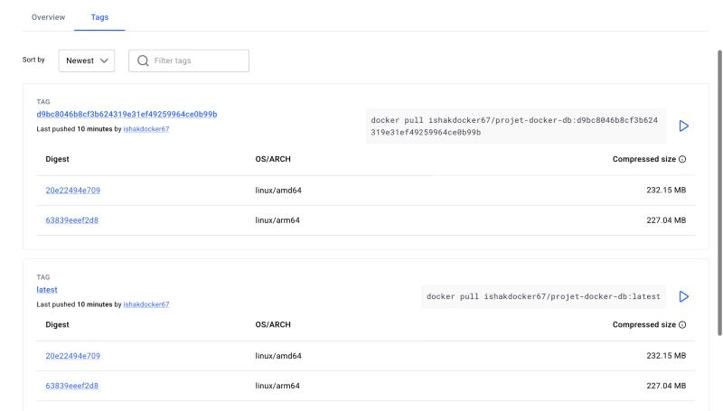

# Livrables

| Livrable | Emplacement |
|---|---|
| Dépôt Git | <https://github.com/Spitchy/Projet_Final_Docker> (branche `main`) |
| Image web (Docker Hub) | <https://hub.docker.com/r/ishakdocker67/projet-docker-web> |
| Image base de données (Docker Hub) | <https://hub.docker.com/r/ishakdocker67/projet-docker-db> |
| Pipeline CI/CD | <https://github.com/Spitchy/Projet_Final_Docker/actions> |
| Rapport technique | ce document (`docs/rapport-technique.pdf` dans le dépôt) |
| Documentation d'utilisation | `README.md` (et `README.pdf`) à la racine du dépôt |

Déploiement en trois commandes, sur toute machine équipée de Docker :

```bash
git clone https://github.com/Spitchy/Projet_Final_Docker.git && cd Projet_Final_Docker
./scripts/init-secrets.sh
docker compose up -d --build --wait     # puis http://localhost:8080
```

Le code source complet des fichiers Docker (Dockerfiles, Compose, pipeline) figure en annexe.

# Introduction

L'application fournie est un petit gestionnaire d'articles. Une page PHP affiche la liste des articles et un formulaire. Un second script, `validation.php`, insère les nouveaux articles dans une base MySQL. Au départ, tout est prévu pour tourner sur une seule machine : connexion à `localhost`, identifiants `test/test` écrits en dur, utilisateur MySQL limité à `'test'@'localhost'`.

L'objectif est de la faire passer sur une architecture multi-conteneurs orchestrée par Docker Compose. Le rapport suit les huit parties du sujet. Pour chacune, il présente le choix retenu, sa justification et la preuve que ça fonctionne (sorties de commandes relevées sur notre machine de test : macOS, Docker Desktop 29.9, Compose v5.6).

# Partie 1 — Conception de l'architecture

## 1.1 Analyse de l'application fournie

| Fichier | Constat | Conséquence en conteneur |
|---|---|---|
| `db-config.php` | DSN `mysql:host=localhost`, identifiants en dur | Dans le conteneur web, `localhost` désigne le conteneur lui-même : la connexion échoue. |
| `articles.sql` | `CREATE USER 'test'@'localhost'` | L'utilisateur ne peut pas se connecter depuis une autre IP (le conteneur web). |
| `index.php` | Affichage brut de `title`, `author`, `content` | Faille XSS stockée. |
| `validation.php` | `isset($_POST["title"])` testé à la place de l'auteur ; `echo` avant `header()` | Validation incomplète et redirection qui échoue. |
| `index.php` | `display_errors=1`, message PDO affiché | Fuite d'informations (hôte, utilisateur SQL). |

Nous avons gardé le comportement fonctionnel et corrigé ces points. La configuration est désormais lue dans l'environnement (`DB_HOST`, `DB_NAME`, `DB_USER`), et le mot de passe dans un secret (`DB_PASSWORD_FILE`). Toutes les sorties passent par `htmlspecialchars`. Un script `healthz.php` permet au healthcheck de vérifier la chaîne Apache → PHP → MySQL.

## 1.2 Architecture retenue


| Composant | Choix | Justification |
|---|---|---|
| Service web | `php:8.2-apache` | Image officielle, PHP et Apache dans un seul processus maître. On évite un second conteneur Nginx pour une application de deux pages. |
| Service base | `mysql:8.4` | Branche LTS de MySQL 8, maintenue jusqu'en 2032, compatible avec le script fourni. |
| Administration | `adminer:5` (profil `admin`) | Un seul fichier PHP, bien plus léger que phpMyAdmin. Démarré uniquement à la demande et lié à `127.0.0.1`. |
| Réseau | bridge personnalisé `app-network` | DNS interne (résolution du nom `db`) et isolation des autres conteneurs de la machine. |
| Volume | volume nommé `db-data` | Persistance de `/var/lib/mysql`, géré par Docker et indépendant du cycle de vie des conteneurs. |
| Configuration | `.env` + secrets fichiers | Pas de valeur sensible dans les images ni dans le dépôt Git. |

Seul le port 8080 de l'hôte est publié. La base n'est joignable que depuis le réseau `app-network`.

# Partie 2 — Dockerfiles optimisés et sécurisés

## 2.1 Image web (`web/Dockerfile`)

Le Dockerfile comporte trois étapes :

```dockerfile
FROM php:${PHP_VERSION}-apache AS builder
RUN docker-php-ext-install -j"$(nproc)" pdo_mysql mysqli

FROM builder AS test
COPY src/ /app/
RUN find /app -name '*.php' -print0 | xargs -0 -n1 php -l

FROM php:${PHP_VERSION}-apache AS runtime
...
```

Justification instruction par instruction :

| Instruction | Rôle et justification |
|---|---|
| `# syntax=docker/dockerfile:1` | Active la dernière syntaxe BuildKit, nécessaire pour `COPY --chmod`. |
| `ARG PHP_VERSION=8.2` | Permet de monter de version sans réécrire le fichier. |
| `FROM php:8.2-apache AS builder` | Étape de compilation. Les en-têtes et les fichiers objets produits par `docker-php-ext-install` restent dans cette étape. |
| `RUN docker-php-ext-install pdo_mysql mysqli` | Extensions demandées par le sujet. `pdo_mysql` est utilisée par l'application. `-j$(nproc)` parallélise la compilation. |
| `FROM builder AS test` + `php -l` | Étape de test ciblée par la CI (`docker build --target test`). Une erreur de syntaxe fait échouer le build. Elle n'apparaît pas dans l'image finale. |
| `FROM php:8.2-apache AS runtime` | Image finale, repartie d'une base propre. |
| `LABEL org.opencontainers.image.*` | Métadonnées OCI standard (titre, description, source), affichées par Docker Hub. |
| `RUN apt-get update && apt-get upgrade -y && apt-get install --no-install-recommends curl iputils-ping && apt-get purge ... && apt-get clean && rm -rf /var/lib/apt/lists/*` | Une seule couche. Elle applique les correctifs de sécurité Debian et installe `curl` (healthcheck) et `ping` (tests réseau demandés) sans paquets recommandés. Elle supprime les compilateurs hérités de l'image de base (`$PHPIZE_DEPS`, `libc6-dev`, `linux-libc-dev`) et vide le cache apt dans la même couche, sinon il resterait dans l'image. |
| `COPY --from=builder .../extensions/` et `.../docker-php-ext-*.ini` | Récupère uniquement les `.so` compilés et leurs fichiers d'activation. |
| `RUN cp php.ini-production php.ini` | Configuration PHP de production (erreurs non affichées, limites raisonnables). |
| `COPY web/php/app.ini` | Surcharges : `expose_php=Off`, `display_errors=Off`, logs vers `stderr` (donc `docker logs`), `variables_order=EGPCS` pour que `getenv()` voie les variables Docker. |
| `COPY web/apache/000-default.conf` | VirtualHost : `DocumentRoot /var/www/html`, `Options -Indexes`, `AllowOverride None`, en-têtes `X-Content-Type-Options`, `X-Frame-Options`, `Referrer-Policy`. Les appels au healthcheck sont exclus du log d'accès. |
| `COPY web/apache/security.conf` + `a2enconf` | `ServerTokens Prod`, `ServerSignature Off`, `TraceEnable Off` : Apache n'annonce plus sa version. |
| `RUN a2enmod headers && a2dismod -f autoindex status` | Active le module nécessaire aux en-têtes et désactive le listing de répertoires et la page `/server-status`. |
| `COPY --chown=root:www-data --chmod=0640 src/ /var/www/html/` | Copie le code source. Il appartient à root : Apache (`www-data`) peut le lire mais pas le modifier. |
| `RUN chown root:www-data /var/www/html && chmod 0750 /var/www/html` | Dans l'image de base, le DocumentRoot est en `1777` (inscriptible par tous). On le restreint. |
| `USER www-data` | Apache et PHP tournent sans privilèges root. |
| `EXPOSE 80` | Documente le port d'écoute. Un utilisateur non-root peut ouvrir le port 80 car Docker fixe `net.ipv4.ip_unprivileged_port_start=0` dans les conteneurs ; c'est vérifié avec `cat /proc/sys/net/ipv4/ip_unprivileged_port_start`. |
| `HEALTHCHECK CMD curl -fsS http://127.0.0.1/healthz.php` | Le conteneur passe à l'état `healthy` seulement si Apache, PHP et la base répondent : `healthz.php` exécute `SELECT 1` et renvoie 503 en cas d'échec. |

Pas de `CMD` ni d'`ENTRYPOINT` : ceux de l'image officielle (`apache2-foreground`) conviennent.

## 2.2 Image base de données (`db/Dockerfile`)

| Instruction | Rôle et justification |
|---|---|
| `FROM --platform=$BUILDPLATFORM golang:1.27-alpine AS gosu` | Étape de compilation de `gosu`. Elle s'exécute sur l'architecture de la machine de build et compile pour l'architecture cible (`GOOS`/`GOARCH`) : pas d'émulation QEMU, même pour l'image arm64. |
| `ADD https://github.com/tianon/gosu.git#1.20 /src` + `go build` | Récupère les sources de gosu 1.20 et les compile avec Go 1.27 (`CGO_ENABLED=0`, binaire statique, `-trimpath -ldflags="-s -w"`). Le gosu de l'image officielle est compilé avec go1.24.6, qui contient une CVE critique (voir partie 5.1). |
| `FROM mysql:8.4` | Image officielle, version LTS. |
| `COPY --from=gosu /gosu /usr/local/bin/gosu` | Remplace le binaire vulnérable par celui que nous avons compilé. L'entrypoint officiel l'utilise sans modification. |
| `ENV MYSQL_DATABASE=test MYSQL_USER=test` | Valeurs par défaut non sensibles. **Aucun mot de passe** : ils arrivent au démarrage via `MYSQL_PASSWORD_FILE` et `MYSQL_ROOT_PASSWORD_FILE`. |
| `RUN microdnf remove -y mysql-shell && microdnf clean all` | MySQL Shell est un client d'administration inutile au serveur. Il embarque des bibliothèques Python vulnérables, dont une CVE critique sur `certifi` (voir partie 5). |
| `COPY conf.d/ /etc/mysql/conf.d/` | `utf8mb4` par défaut, `local_infile=OFF` (empêche la lecture de fichiers via `LOAD DATA LOCAL`), `skip-name-resolve`. |
| `COPY init/ /docker-entrypoint-initdb.d/` | Exécuté une seule fois par l'entrypoint officiel, quand le volume est vide. |
| `EXPOSE 3306` | Documentation uniquement : le port n'est pas publié sur l'hôte. |
| `HEALTHCHECK CMD mysqladmin ping -h 127.0.0.1` | Indique quand le serveur accepte les connexions. Le service web attend cet état. |

Le script `articles.sql` a été adapté :

- il ne crée plus la base ni l'utilisateur, c'est l'entrypoint qui s'en charge avec `'test'@'%'` ;
- la table est en `utf8mb4` (le jeu `utf8` de MySQL, sur 3 octets, ne gère pas tous les caractères) ;
- un article d'exemple est inséré ;
- `SET NAMES utf8mb4;` en tête de fichier, pour que les accents soient bien interprétés (voir partie 8.3).

Le processus `mysqld` tourne sous l'utilisateur `mysql` (UID 999) : l'entrypoint officiel abandonne les droits root avec `gosu`, que nous avons recompilé. Nous l'avons vérifié avec `grep Uid /proc/1/status`, qui renvoie `999`.

## 2.3 Bonnes pratiques

**`.dockerignore`** — nous avons choisi une liste blanche plutôt qu'une liste noire :

```
*
!src/
!web/
web/Dockerfile
```

Le contexte envoyé au démon ne contient que ce qui est copié. `.git`, `.env`, `secrets/`, la documentation et le `.docx` ne peuvent donc pas se retrouver dans une image, même par un `COPY . .` maladroit. Le contexte de l'image `db` (`db/.dockerignore`) se limite de la même façon à `conf.d/` et `init/`.

**Pourquoi `chmod 777` est une faille.** `777` donne lecture, écriture et exécution au propriétaire, au groupe et à *tous les autres utilisateurs*. Pour un DocumentRoot, cela signifie :

1. une faille applicative (upload, injection, inclusion de fichier) permet à n'importe quel processus du conteneur de **réécrire le code PHP** et d'y installer une porte dérobée (*webshell*) persistante ;
2. on perd le cloisonnement entre utilisateurs, qui est la base du modèle de sécurité Unix : un processus compromis non privilégié obtient l'accès en écriture à tout ;
3. sur un volume partagé, la permission s'applique aussi aux utilisateurs de l'hôte.

On l'utilise souvent pour « faire marcher » un problème de permissions sans en comprendre la cause. Nous avons appliqué le principe du moindre privilège : code en `0640` (fichiers) et `0750` (dossier), propriétaire `root`, groupe `www-data`. Apache lit le code mais ne peut ni le modifier ni créer de fichier. Avec `read_only: true` dans Compose, la protection est doublée.

# Partie 3 — Orchestration avec Docker Compose

## 3.1 Rôle de chaque section du fichier

| Section | Rôle |
|---|---|
| `name:` | Nom du projet Compose, préfixe du volume (`projet-docker_db-data`). |
| `services.web.build` | Contexte (racine du dépôt, filtré par `.dockerignore`) et chemin du Dockerfile. |
| `services.*.image` | Nom de l'image construite : `${DOCKERHUB_USER}/projet-docker-web:${TAG}`. Le même fichier sert à construire, publier (`docker compose push`) et tirer (`docker compose pull`). |
| `container_name` | Noms fixes `web` et `db`, pour que les commandes du sujet (`docker exec -it web ping db`) fonctionnent telles quelles. |
| `ports` | `web` publie `${WEB_PORT}:80`. `db` n'a **pas** de section `ports`. Adminer n'est lié qu'à `127.0.0.1`. |
| `environment` | Configuration non sensible, interpolée depuis `.env`. Pour les mots de passe, seuls les **chemins** des secrets sont passés (`*_FILE`). |
| `secrets` | Monte `secrets/*.txt` dans `/run/secrets/` (lecture seule, hors image). |
| `networks` | Rattache les services au bridge `app-network`. |
| `volumes` | `db-data:/var/lib/mysql` : données MySQL persistantes. |
| `depends_on.condition: service_healthy` | `web` ne démarre que lorsque `db` répond, ce qui évite les erreurs de connexion au premier lancement. |
| `healthcheck` | Repris du Dockerfile et rendu explicite dans Compose. Les paramètres `interval`, `timeout`, `retries` et `start_period` sont adaptés à chaque service. MySQL a besoin de ~20 s au premier démarrage. |
| `restart: unless-stopped` | Redémarre le conteneur après un crash ou un reboot du démon, sauf s'il a été arrêté volontairement. |
| `read_only`, `tmpfs`, `cap_drop`, `cap_add`, `security_opt` | Durcissement (voir partie 5). |
| `deploy.resources.limits` | Plafonds CPU et mémoire (0,5 CPU / 256 Mo pour web, 1 CPU / 768 Mo pour db) : un service emballé ne peut pas saturer l'hôte. |
| `profiles: ["admin"]` | Adminer ne démarre qu'avec `--profile admin`. |
| `networks.app-network` | Réseau bridge nommé explicitement `app-network`. |
| `volumes.db-data` | Déclaration du volume nommé. |
| `secrets.*.file` | Source des secrets. |

## 3.2 Lancement et vérification

```
$ docker compose up -d --wait
 Container db   Healthy
 Container web  Healthy
$ docker compose ps
NAME   STATUS                    PORTS
db     Up 16 seconds (healthy)   3306/tcp, 33060/tcp
web    Up 5 seconds (healthy)    0.0.0.0:8080->80/tcp
```

L'application répond sur http://localhost:8080 :



## 3.3 Test de persistance

Étape 1 : nous avons ajouté un article depuis le formulaire de l'interface web.



Étape 2 : suppression puis recréation des conteneurs.

```
$ docker compose down
 Container web  Removed
 Container db   Removed
 Network app-network  Removed
$ docker compose up -d --wait
 Container db   Healthy
 Container web  Healthy
$ docker compose ps
NAME  IMAGE                                   STATUS                   PORTS
db    ishakdocker67/projet-docker-db:latest   Up 11 seconds (healthy)  3306/tcp, 33060/tcp
web   ishakdocker67/projet-docker-web:latest  Up 5 seconds (healthy)   0.0.0.0:8080->80/tcp
```

Étape 3 : après rechargement de la page, l'article est toujours présent.



`docker compose down` supprime les conteneurs et le réseau, mais pas les volumes nommés. Au redémarrage, MySQL trouve un `/var/lib/mysql` déjà initialisé : le script d'initialisation n'est pas rejoué et les données sont intactes. Seul `docker compose down -v` efface le volume.

Nous avons aussi validé la correction XSS avec un article piégé :

- titre : `<script>alert("XSS")</script>` ;
- contenu : ``.

Il s'affiche comme du texte et aucun script n'est exécuté :



Un formulaire sans auteur renvoie un code 400 et le message « Il manque le nom de l'auteur de l'article ».

# Partie 4 — Réseaux et communication inter-conteneurs

```
$ docker network ls --filter name=app-network
NETWORK ID     NAME          DRIVER    SCOPE
76516ee5f52b   app-network   bridge    local

$ docker network inspect app-network
app-network driver=bridge subnet=172.18.0.0/16 | db 172.18.0.2/16 | web 172.18.0.3/16

$ docker exec -it web ping -c 2 db
PING db (172.18.0.2) 56(84) bytes of data.
64 bytes from db.app-network (172.18.0.2): icmp_seq=1 ttl=64 time=0.523 ms
64 bytes from db.app-network (172.18.0.2): icmp_seq=2 ttl=64 time=0.183 ms
2 packets transmitted, 2 received, 0% packet loss

$ docker exec -it web curl http://db:3306
curl: (1) Received HTTP/0.9 when not allowed
$ docker exec -it web curl --http0.9 http://db:3306 --output - | strings | head -1
8.4.13
```

Le nom `db` est résolu par le **DNS embarqué de Docker** (127.0.0.11), disponible uniquement sur les réseaux personnalisés. L'erreur de `curl` est normale : le port 3306 répond, mais avec le protocole MySQL et non HTTP. Le paquet d'accueil du serveur contient d'ailleurs sa version (`8.4.13`). La connexion TCP inter-conteneurs fonctionne donc.

Depuis l'hôte, `nc -z localhost 3306` échoue : la base n'est pas exposée.

**Isolation et intérêt du bridge personnalisé.** Le réseau `bridge` par défaut ne fournit pas de résolution par nom : il faudrait utiliser des IP qui changent, ou l'option obsolète `--link`. Il est aussi partagé par tous les conteneurs lancés sans option réseau. Un bridge personnalisé apporte :

- un DNS automatique par nom de service, donc une configuration indépendante des IP ;
- l'isolation : seuls les conteneurs explicitement rattachés à `app-network` peuvent joindre `db`, et un conteneur lancé à côté sur la même machine ne voit pas la base ;
- un contrôle de l'exposition : seuls les ports déclarés dans `ports:` sont accessibles depuis l'extérieur, ici le 8080 du service web ;
- la possibilité, si besoin, de passer le réseau en `internal: true` ou de séparer un réseau front et un réseau back sans toucher au code.

# Partie 5 — Sécurité et bonnes pratiques

## 5.1 Scan de vulnérabilités (Trivy)

Trivy est lancé depuis son image officielle, sans installation locale :

```bash
docker run --rm -v /var/run/docker.sock:/var/run/docker.sock \
  aquasec/trivy:0.76.1 image --scanners vuln --severity HIGH,CRITICAL <image>
```

| Image | Premier scan | Après corrections | Évolution |
|---|---|---|---|
| web | 120 (117 HIGH, **3 CRITICAL**) | 59 (58 HIGH, **1 CRITICAL**) | −51 % |
| db | 35 (33 HIGH, **2 CRITICAL**) | **0** (0 HIGH, **0 CRITICAL**) | −100 % |

Corrections appliquées :

1. **web — `linux-libc-dev` (CRITICAL)** : ce paquet d'en-têtes noyau n'est utile qu'à la compilation. L'image `php:8.2-apache` garde la chaîne de compilation (`gcc`, `g++`, `make`, `libc6-dev`...) pour `docker-php-ext-install`. Comme nous compilons dans l'étape `builder`, l'image finale peut la supprimer. Cela élimine aussi des dizaines de CVE HIGH (gcc, binutils, perl...).
2. **web — `apt-get upgrade`** : intègre les correctifs Debian publiés après la construction de l'image de base.
3. **db — `certifi` (CRITICAL) + `cryptography`, `pyOpenSSL`, `urllib3` (HIGH)** : ces bibliothèques Python sont embarquées par MySQL Shell. Ce client n'est pas nécessaire au serveur, nous l'avons désinstallé.
4. **db — Go stdlib CVE-2025-68121 (CRITICAL) + 25 CVE HIGH dans `gosu`** : `gosu` est le petit binaire qui permet à l'entrypoint MySQL de passer de root à l'utilisateur `mysql`. Celui de l'image officielle est compilé avec go1.24.6, une version vulnérable (faille de validation des certificats TLS dans `crypto/tls`). Une étape `gosu` du `db/Dockerfile` recompile gosu 1.20 depuis ses sources avec Go 1.27 (compilation croisée pour amd64 et arm64), puis remplace le binaire d'origine. Après correction, Trivy ne trouve plus aucune vulnérabilité HIGH ou CRITICAL dans l'image db.

Vulnérabilité critique restante (risque accepté et documenté) :

- **web — `libxml2` CVE-2026-6653** : *use-after-free* dans l'analyse de la DTD interne (`xmlParseInternalSubset`). Un document XML piégé peut provoquer un plantage, donc un déni de service. PHP est lié à libxml2 (extensions `dom`, `xml`, `SimpleXML`), on ne peut donc pas retirer la bibliothèque. Le correctif n'existe que dans libxml2 ≥ 2.11. Debian l'a classé *no-dsa (Minor issue)* pour Debian 13 et ne le corrigera que dans la version suivante (forky). Notre application ne lit jamais de XML : aucune donnée utilisateur n'atteint ce code. Le scan bloquant de la CI utilise `--ignore-unfixed` : il échouera automatiquement dès que Debian publiera un correctif et que l'image n'aura pas été reconstruite. Seule alternative : une image Alpine (Nginx + PHP-FPM), dont le libxml2 n'est pas concerné (voir partie 6.3).

Docker Scout donne un résultat équivalent : `docker scout cves <image>`.

## 5.2 Gestion des secrets

- Aucun mot de passe dans les Dockerfiles, les images, le dépôt Git ou les variables d'environnement.
- `scripts/init-secrets.sh` génère deux mots de passe aléatoires (24 octets de `/dev/urandom`) dans `secrets/`, un dossier ignoré par Git.
- Compose les monte dans `/run/secrets/` (secrets de type `file`). Les images officielles MySQL lisent `MYSQL_PASSWORD_FILE`. L'application lit `DB_PASSWORD_FILE` via la fonction `readSecret()` de `db-config.php`.
- Vérification : `docker exec web env | grep -i pass` ne renvoie que `DB_PASSWORD_FILE=/run/secrets/db_password`, un chemin et non une valeur. À l'inverse, une variable `MYSQL_PASSWORD` apparaîtrait en clair dans `docker inspect`.

`docker secret` (mode Swarm) n'a pas été utilisé, car la stack tourne avec Compose sans cluster. Les secrets Compose de type `file` offrent la même interface (`/run/secrets/<nom>`) : le passage à Swarm ne demanderait aucune modification des images.

## 5.3 Limitation des privilèges

| Mesure | web | db | Preuve |
|---|---|---|---|
| Utilisateur non-root | `USER www-data` (UID 33) | `mysql` (UID 999) via l'entrypoint | `docker exec web id` → `uid=33(www-data)` |
| Système de fichiers racine en lecture seule | `read_only: true` | `read_only: true` | `touch /etc/test` → *Read-only file system* |
| Répertoires inscriptibles | tmpfs `/var/run/apache2`, `/var/lock/apache2`, `/tmp` | tmpfs `/var/run/mysqld`, `/tmp` + volume `db-data` | |
| Capacités Linux | `cap_drop: [ALL]`, aucune ajoutée | `cap_drop: [ALL]` + `CHOWN`, `SETUID`, `SETGID`, `DAC_OVERRIDE` | `docker inspect` |
| Escalade de privilèges (setuid) | `no-new-privileges` | `no-new-privileges` | |
| Limites de ressources | 0,5 CPU / 256 Mo | 1 CPU / 768 Mo | |

Les quatre capacités de `db` sont le minimum nécessaire. Nous l'avons vérifié en retirant chacune d'elles une à une :

```
sans DAC_OVERRIDE : find: '/var/lib/mysql-files': Permission denied
sans CHOWN        : chown: changing ownership of '/var/run/mysqld': Operation not permitted
sans SETUID       : [ERROR] [Server] setuid: Operation not permitted
```

Mesures applicatives complémentaires :

- échappement XSS ;
- requêtes préparées (déjà présentes, conservées) ;
- erreurs envoyées dans les logs et non affichées ;
- en-têtes HTTP de sécurité ;
- Apache et PHP ne divulguent plus leur version.

# Partie 6 — Optimisation des images

## 6.1 Comparaison avant / après

Pour mesurer les gains, nous avons construit une version « naïve » de l'image web ([`docs/Dockerfile.naive`](Dockerfile.naive)) :

- une instruction `RUN` par commande apt ;
- des outils inutiles (`vim`, `git`, `unzip`) ;
- aucun nettoyage du cache apt ;
- `COPY . /var/www/html/` sans `.dockerignore` adapté ;
- `chmod -R 777`.

| Image | Taille | Écart par rapport à la base |
|---|---|---|
| `php:8.2-apache` (base officielle) | 714 Mo | — |
| Version naïve | 890 Mo | **+176 Mo** |
| **Version optimisée** | **716 Mo** | **+2 Mo** |

La couche la plus lourde de notre image (`docker history`) pèse 975 ko : c'est la couche apt (curl, ping, mises à jour). Les extensions compilées occupent 299 ko et le code, la configuration et les fichiers ini quelques dizaines de ko.

## 6.2 Techniques utilisées

- **Multi-stage build** : la compilation se fait dans `builder`. Seuls les `.so` sont copiés dans l'image finale, sans en-têtes, objets intermédiaires ni sources PHP décompressées. L'étape `test` permet de lancer `php -l` dans la CI sans rien ajouter à l'image publiée.
- **Couche apt unique et nettoyée** : `update`, `install` et `rm -rf /var/lib/apt/lists/*` sont dans la même instruction. Sur des `RUN` séparés, le cache serait figé dans une couche intermédiaire.
- **`--no-install-recommends`** : seuls les paquets demandés et leurs dépendances strictes sont installés.
- **`.dockerignore` en liste blanche** : contexte de build de quelques ko, builds plus rapides et cache stable.
- **Ordre des instructions** : du moins volatil (paquets système, extensions) au plus volatil (code source). Modifier un fichier PHP ne reconstruit que les dernières couches.

## 6.3 Limites et piste alpine

La taille finale reste dominée par la base Debian de `php:8.2-apache`, environ 714 Mo selon `docker image inspect`. Supprimer des paquets dans une couche supérieure (compilateurs) masque les fichiers sans réduire la taille, car les couches de base restent présentes. C'est pourquoi la purge des compilateurs améliore la sécurité mais pas la taille.

Pour descendre sous les 100 Mo, il faudrait passer sur `php:8.2-fpm-alpine` + Nginx, l'autre architecture permise par le sujet. Nous avons gardé Apache car :

- un seul processus suffit pour cette application ;
- la configuration reste plus simple à auditer ;
- les images Debian restent compatibles avec la glibc ;
- la différence de taille ne pèse rien face à la base MySQL (environ 1,1 Go), qui ne peut pas être réduite.

# Partie 7 — CI/CD et publication

## 7.1 Pipeline GitHub Actions

Fichier : `.github/workflows/docker.yml`. Déclencheurs : `push` (toutes les branches), `pull_request` vers `main` et `workflow_dispatch`.

| Job | Contenu |
|---|---|
| `lint` | `php -l` sur tous les fichiers `src/*.php`, dans un conteneur `php:8.2-cli`. |
| `build-test` | `docker build --target test`, génération de `.env` et des secrets, `docker compose config`, `docker compose build`, `up --wait` (attente des healthchecks), puis les tests fonctionnels : page d'accueil, `/healthz.php`, ajout d'un article (302), relecture, formulaire incomplet (400), `ping db`, UID 33, écriture refusée. Ensuite un test de persistance (`down` puis `up`, l'article est toujours présent) et un **scan Trivy bloquant** sur les vulnérabilités CRITICAL corrigeables. Les logs sont affichés en cas d'échec. |
| `publish` | Uniquement sur `push` vers `main`, après réussite de `build-test`. Connexion à Docker Hub via `secrets.DOCKERHUB_USERNAME` / `secrets.DOCKERHUB_TOKEN`. Tags générés par `docker/metadata-action` : `latest` et le **SHA complet du commit**. Build et push multi-architecture (`linux/amd64`, `linux/arm64`) avec `docker/build-push-action` et un cache GitHub Actions. Une matrice traite les deux images. |

Choix notables :

- `permissions: contents: read` : le jeton GitHub n'a que les droits minimaux.
- Trivy est lancé depuis son image officielle épinglée (`aquasec/trivy:0.76.1`) plutôt que via une action tierce. Nous voulions limiter la surface d'attaque *supply chain* du pipeline.
- Le job `build-test` rejoue exactement la procédure « cloner sur une autre machine et lancer `docker compose up -d` » demandée en partie 8, sur un runner vierge, à chaque push.

Nous avons validé le workflow localement avec `actionlint` (aucune erreur), puis rejoué toutes ses étapes sur un clone vierge du dépôt. Tous les tests passent et les deux scans Trivy bloquants renvoient le code 0.

## 7.2 Publication sur Docker Hub

Préparation, à faire une fois :

1. Créer un compte sur hub.docker.com et deux dépôts publics : `projet-docker-web` et `projet-docker-db`.
2. *Account settings → Personal access tokens* : créer un jeton *Read & Write*.
3. Dans GitHub (*Settings → Secrets and variables → Actions*), créer `DOCKERHUB_USERNAME` et `DOCKERHUB_TOKEN`.

Ensuite, chaque push sur `main` publie automatiquement les images. Publication manuelle équivalente :

```bash
docker login
docker tag local/projet-docker-web:latest ishakdocker67/projet-docker-web:latest
docker push ishakdocker67/projet-docker-web:latest
# ou, avec DOCKERHUB_USER renseigné dans .env :
docker compose build && docker compose push
```

Vérification : `docker pull ishakdocker67/projet-docker-web:latest` sur une autre machine, et l'onglet *Tags* du dépôt Docker Hub.

## 7.3 Résultat

Le pipeline exécuté sur `main` (commit `d9bc804`) a réussi ses quatre jobs en 7 min 20 s : lint, build/tests/scan, puis publication des deux images. Tags présents sur Docker Hub, chacun pour `amd64` et `arm64` :

| Dépôt | Tags |
|---|---|
| [`ishakdocker67/projet-docker-web`](https://hub.docker.com/r/ishakdocker67/projet-docker-web) | `latest`, `d9bc8046b8cf3b624319e31ef49259964ce0b99b` |
| [`ishakdocker67/projet-docker-db`](https://hub.docker.com/r/ishakdocker67/projet-docker-db) | `latest`, `d9bc8046b8cf3b624319e31ef49259964ce0b99b` |







Docker Hub affiche les tailles **compressées** : 168 Mo pour l'image web (contre 716 Mo décompressés en local) et 232 Mo pour la base. C'est le volume réellement téléchargé lors d'un `docker pull`.

La première exécution sur `main` avait échoué avec `invalid tag "/projet-docker-db:latest"`. Le secret `DOCKERHUB_USERNAME` contenait un caractère parasite (probablement un retour à la ligne collé avec la valeur), ce qui coupait le nom d'image en deux. Le workflow nettoie désormais le nom d'utilisateur (suppression des espaces, passage en minuscules) et vérifie la présence des secrets avant toute connexion. Nous avons aussi désactivé `fail-fast` pour qu'une image en échec n'annule plus la publication de l'autre.

# Partie 8 — Tests, documentation et soutenance

## 8.1 Récapitulatif des tests

| Test | Commande | Résultat |
|---|---|---|
| Validation Compose | `docker compose config -q` | OK |
| Démarrage | `docker compose up -d --wait` | web et db `healthy` |
| Page d'accueil | `curl localhost:8080` | liste des articles |
| Ajout d'article | POST `validation.php` | 302, article affiché |
| Formulaire incomplet | POST sans auteur | 400 + message |
| XSS | titre `<script>` | affiché échappé |
| Persistance | `down` puis `up` | article conservé |
| DNS inter-conteneurs | `docker exec web ping db` | 0 % de perte |
| Port MySQL | `docker exec web curl db:3306` | réponse MySQL 8.4.13 |
| Isolation | `nc -z localhost 3306` | fermé |
| Non-root | `docker exec web id` | `uid=33(www-data)` |
| Lecture seule | `docker exec web touch /etc/x` | refusé |
| Vulnérabilités | Trivy CRITICAL corrigeables | 0 (image db : 0 HIGH / CRITICAL) |
| Clone vierge | `git clone` puis `init-secrets.sh` et `up` | stack `healthy`, tests OK |
| Pipeline GitHub Actions | push sur `main` | 4 jobs verts, images publiées |

## 8.2 Documentation

Le `README.md` couvre l'architecture, les prérequis, les commandes de déploiement, les variables d'environnement et secrets, la procédure de test complète, la sécurité, la CI/CD et le dépannage.

## 8.3 Difficultés rencontrées et choix techniques

- **Utilisateur MySQL `'test'@'localhost'`** : fourni par le script d'origine, il empêchait toute connexion depuis le conteneur web. Nous avons délégué la création de l'utilisateur à l'image officielle (`MYSQL_USER`), qui crée `'test'@'%'`.
- **Secrets et `read_only`** : la première version transmettait les mots de passe via des secrets Compose de source `environment`. Compose refuse ce mode sur un conteneur en lecture seule (*« `file` is the sole supported option »*). Nous sommes passés à des secrets de type `file`, générés par un script. Le résultat est plus propre : les mots de passe ne figurent même plus dans `.env`.
- **Capacités minimales de MySQL** : `cap_drop: ALL` seul empêche l'entrypoint de démarrer, car il doit changer le propriétaire des répertoires puis passer à l'utilisateur `mysql`. Nous avons déterminé par essais successifs les quatre capacités indispensables (partie 5.3).
- **Apache non-root sur le port 80** : pas besoin de `NET_BIND_SERVICE` ni de changer de port, car Docker abaisse `ip_unprivileged_port_start` à 0 dans les conteneurs.
- **`curl http://db:3306`** : la commande du sujet renvoie une erreur HTTP/0.9, ce qui est normal pour un port MySQL. L'option `--http0.9` permet de montrer la réponse du serveur.
- **Accents corrompus dans l'article d'exemple** : en vérifiant l'interface, nous avons vu « créé » au lieu de « créé ». Le client `mysql` de l'entrypoint lit les scripts d'initialisation en latin1, alors que le fichier est en UTF-8. Nous avons ajouté `SET NAMES utf8mb4;` en tête de `01-articles.sql`. Les articles saisis via le formulaire n'étaient pas concernés, car PDO se connecte déjà en `charset=utf8mb4`.
- **Vulnérabilités de l'image de base** : la purge des compilateurs n'a de sens que grâce au build multi-stage. La CVE sans correctif (libxml2) est documentée plutôt que masquée : aucune exception n'est déclarée dans la CI, et son scan la signalera dès qu'un correctif sera publié.
- **Recompilation de gosu** : `go install github.com/tianon/gosu@v1.20` échoue (*no matching versions*), car les tags de gosu (`1.20`) ne respectent pas le format de version des modules Go (`v1.20.0`). Nous récupérons donc les sources au tag voulu (`ADD https://github.com/tianon/gosu.git#1.20`) puis les compilons avec `go build`.

# Conclusion

Après conteneurisation, l'application démarre avec deux commandes sur n'importe quelle machine équipée de Docker. Les données sont persistantes et les services isolés sur un réseau dédié. Chaque conteneur tourne avec le minimum de privilèges. Les images sont reconstruites, testées, scannées et publiées automatiquement à chaque modification. Pour aller plus loin :

- une variante Alpine (Nginx + PHP-FPM) pour réduire la taille ;
- la signature des images (Docker Content Trust / cosign) ;
- un reverse proxy avec TLS devant le service web.
